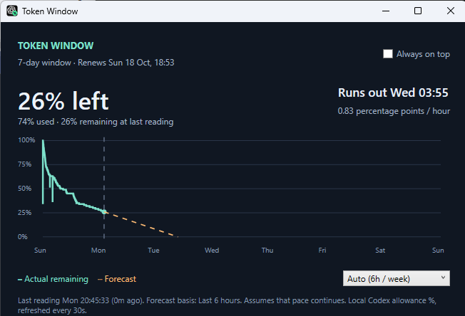

# Token Window

Token Window is an open-source Windows desktop widget that helps you see how much of your weekly Codex allowance remains and whether your current pace will exhaust it before renewal. It shows recorded usage across the seven-day window and a dashed burn forecast that adapts to recent activity. Auto mode uses recent six-hour usage with a week-history fallback; manual 6-hour, 24-hour, and whole-week modes are also available. Resize it or enable Always on top.

Codex is currently the supported provider. Support for other providers could be added if people want it—open an issue to request a provider, or contribute an integration.

Contributions are welcome: help improve the forecasting, polish the interface, test different Codex setups, or suggest a feature. Open an issue to share an idea or a bug, or send a pull request with a focused improvement. Let's make this a useful little tool together.



## Contributing

Fork the repository, build the widget using the instructions below, and submit a pull request describing what changed and why. For forecast or log-reader changes, add relevant regression checks and run:

```powershell
dotnet run --project TokenWidget.Tests -c Release
```

Bug reports are especially helpful when they include the widget version or executable path, what you expected, and what happened. Please remove personal conversation content and credentials before sharing logs.

## Run

Build using the .NET 8 SDK or later:

```powershell
dotnet run --project TokenWidget
```

Create a standalone Windows x64 executable (no installed .NET runtime required):

```powershell
dotnet publish TokenWidget -c Release -r win-x64 --self-contained true -p:PublishSingleFile=true -o artifacts/widget
```

## Data and forecast

Reads only `event_msg/token_count` weekly `rate_limits` snapshots from the last eight days under `%USERPROFILE%\.codex\sessions` (or `%CODEX_HOME%\sessions`). Discovers recently modified logs throughout the session tree, including conversations created in older date folders. Accepts a 10,080-minute meter in either primary or secondary. Does not read credentials, contact a service, or modify Codex logs. Refreshes every 30 seconds using incremental shared-file reads. Percentages are recorded account allowance readings, not inferred from raw token counts. Only locally recorded history is available; absent history is not fabricated.

The graph covers exactly renewal minus seven days through renewal, displayed in local time. Actual observations form a stepped remaining-percentage series. Auto estimates percentage-point change divided by elapsed time using observations in the six hours before the current time. This follows the recent model mix through its measured allowance consumption. When that interval has no measurable increase or fewer than 15 minutes of history, Auto falls back to the available observations in the current week. It does not assume an unobserved zero reading at the start of the week. The status shows the chosen basis. Elapsed-time averaging includes idle periods and avoids weighting densely logged conversations more heavily.

For forecasting only, a downward meter excursion that recovers to its prior value within 30 minutes is excluded as a temporary inconsistent snapshot. Unrecovered or sustained downward adjustments start a new forecast segment. Recorded actual graph points remain unchanged. Manual modes use their selected interval ending at the latest reading. The forecast begins at the latest reading and is capped at zero or renewal. “Runs out” means estimated allowance exhaustion; renewal is a separate event. Old readings are labelled stale, and expired windows await new readings rather than silently manufacturing a fresh allowance. Forecasts assume the estimated pace continues; future model changes, idle time, and sparse/rounded observations can change them.

This is a standalone desktop window, not an extension of the Windows Widgets board. No launch-at-login or account switching is configured. Local session logs may contain readings from different accounts if the same Codex home is shared.

## License

Licensed under the [MIT License](LICENSE). You're welcome to use, modify, and contribute to the project. Codex and OpenAI names and logos belong to their respective owners; this is an independent community project.
